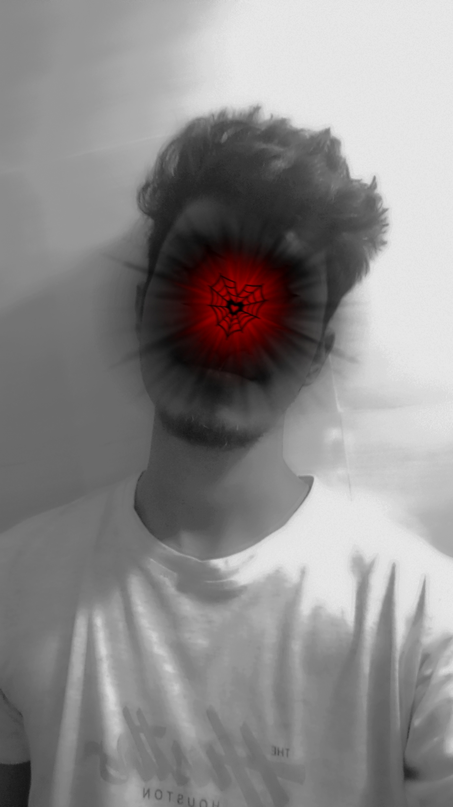

<div align="center">

# 🦋 ALIYA OFFICIAL V4 🦋

### ⚡ Next-Gen Automation • Fast Commands • Cloud-Powered Engine ⚡

<p align="center">
  
</p>

<p align="center">
  
  
  
  
</p>

<p align="center">
  <a href="#-overview">🦋 Overview</a> •
  <a href="#-dashboard-gallery">🖼️ Gallery</a> •
  <a href="#-features">⚡ Features</a> •
  <a href="#-quick-setup">🚀 Setup</a> •
  <a href="#-connect">🌐 Connect</a>
</p>

</div>

---

## 🦋 Overview

**Aliya Official V4 🦋** is a high-speed, modular automation and bot engine built for reliability, direct execution, and smooth cloud integration. Designed to keep things clean, responsive, and easy to maintain.

> *"Clean architecture, fast execution, zero clutter."* — **🤍 Mr.King**

---

## 🖼️ Dashboard Gallery

<div align="center">

<table>
  <tr>
    <td align="center" width="33%">
      
      <br />
      <sub><b>Nightfall Visual</b></sub>
    </td>
    <td align="center" width="33%">
      
      <br />
      <sub><b>Monochrome Vibe</b></sub>
    </td>
    <td align="center" width="33%">
      
      <br />
      <sub><b>0xMr_King Edition</b></sub>
    </td>
  </tr>
</table>

</div>

---

## ⚡ Features

| Module | Highlights |
| :--- | :--- |
| ⚡ **Fast Command Engine** | Low-latency execution with direct, clean responses |
| 🎮 **Interactive Utilities** | Fun commands, mini-games, and smart helpers |
| 🎬 **Media & API Ready** | Smooth integration with external REST APIs and media endpoints |
| ☁️ **Cloud & Database Sync** | Built for scalable hosting and persistent data storage |
| 🔧 **Modular Structure** | Easy to add, update, or customize commands anytime |

---

## 🛠️ Tech Stack

<p align="center">
  
</p>

* **Core:** JavaScript (ES6+), Node.js
* **Database & Cloud:** MongoDB, GitHub, Vercel / Cloud Hosting
* **Process & Environment:** CLI / Termux / Linux / PM2

---

## 🚀 Quick Setup

```bash
# 1. Clone the repository
git clone [https://github.com/mrking-svg/Aliya-Official-v4.git](https://github.com/mrking-svg/Aliya-Official-v4.git)

# 2. Enter project directory
cd Aliya-Official-v4

# 3. Install dependencies
npm install

# 4. Configure environment variables
cp .env.example .env

# 5. Start the project
npm start

🌐 Connect
<div align="center">
🤍 Made with dedication by Mr.King 🦋

</div>
